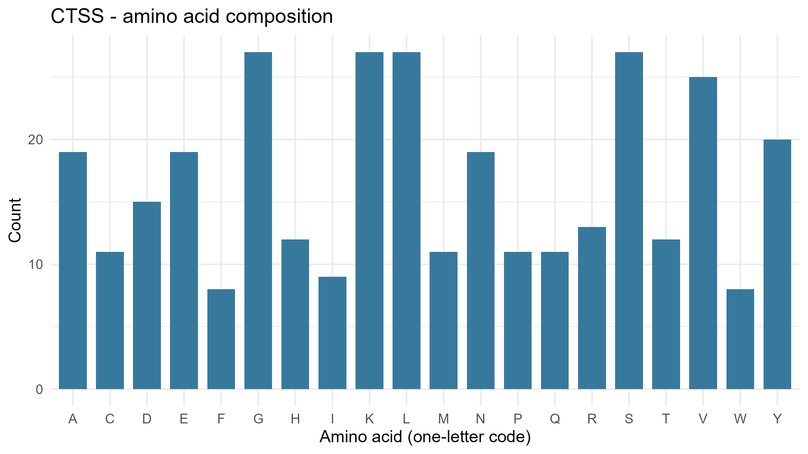
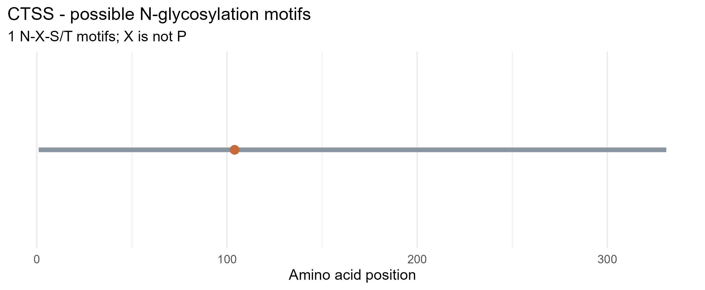

# Exploring Lysosomal Enzymes Using NCBI and R

## Individual Laboratory Activity

### Selected Enzyme

- **Gene symbol:** CTSS
- **Enzyme name:** Cathepsin S
- **Organism:** *Homo sapiens*
- **NCBI RefSeq protein accession:** NP_004070.3
- **Protein length:** 331 amino acids
- **Repository:** lysosomal-enzyme-CTSS

### NCBI Protein Record

[NCBI Protein: Cathepsin S isoform 1 preproprotein (NP_004070.3)](https://www.ncbi.nlm.nih.gov/protein/NP_004070.3)

## Brief Function Description

Cathepsin S is a lysosomal cysteine protease encoded by the CTSS gene. It breaks down proteins into smaller peptides and has an important role in protein processing in lysosomal and endolysosomal compartments. Cathepsin S is also involved in antigen processing and contributes to the processing of proteins associated with major histocompatibility complex class II (MHC-II).

## R Analysis

The supplied R script was used to download the human CTSS protein sequence from NCBI and analyze its amino acid composition and potential N-glycosylation motifs.

The analysis generated the following results:

- **Protein length:** 331 amino acids
- **Potential N-glycosylation motifs:** 1
- **Motif:** NIT
- **Motif position:** 104
- **Most common amino acids:** G, K, L, and S
- **Count of G:** 27 (8.16%)
- **Count of K:** 27 (8.16%)
- **Count of L:** 27 (8.16%)
- **Count of S:** 27 (8.16%)
- **Count of V:** 25 (7.55%)

## Figure 1: Amino Acid Composition

Figure 1 shows the counts of the 20 standard amino acids found in the 331-amino-acid CTSS protein sequence. Glycine (G), lysine (K), leucine (L), and serine (S) were the most common, with 27 residues each.

## Figure 2: Potential N-Glycosylation Motif

Figure 2 shows the location of the potential N-X-S/T motif identified in the CTSS sequence. One motif was detected at position 104. The sequence is NIT, where isoleucine (I) is the middle residue and is not proline.

## Questions and Answers

### 1. What does your enzyme normally break down inside lysosomes?

Cathepsin S is a lysosomal cysteine protease that breaks down proteins into smaller peptides. It also contributes to the processing of proteins involved in antigen presentation.

### 2. What is the total length of your protein, and which amino acids are most common?

The CTSS protein analyzed is **331 amino acids long**. The most common amino acids are glycine (G), lysine (K), leucine (L), and serine (S), with **27 residues each (8.16%)**. Valine (V) was also among the most common, with **25 residues (7.55%)**.

### 3. How many potential N-glycosylation motifs did you find? Where are they located?

The analysis identified **one potential N-glycosylation motif**. It is the sequence **NIT**, located at **amino acid position 104**. It matches the N-X-S/T pattern because the middle residue, isoleucine (I), is not proline.

### 4. Why can glycosylation matter for lysosomal proteins? Does finding a motif prove the protein is glycosylated?

Glycosylation can help proteins fold correctly, maintain stability, and undergo proper cellular processing and trafficking. Some lysosomal enzymes also depend on specific carbohydrate-based signals for delivery to lysosomes. However, finding an N-X-S/T sequence motif does **not** prove that the protein is actually glycosylated. It is only a sequence-based prediction and does not confirm the presence of a glycan or a mannose-6-phosphate (M6P) tag.

### 5. What could happen in the cell if your enzyme did not work properly?

If Cathepsin S did not function properly, protein degradation and processing in lysosomal and endolysosomal compartments could be disrupted. Because Cathepsin S also participates in antigen processing, its dysfunction could affect normal antigen presentation and immune-related cellular processes.

## Files Generated

### R Script

- `lysosomal_enzyme_analysis.R`

### Data

- `data/CTSS.fasta`

### Results

- `results/CTSS_summary.csv`
- `results/CTSS_amino_acid_counts.csv`
- `results/CTSS_motif_positions.csv`

### Figures

- `figures/CTSS_amino_acid_composition.png`
- `figures/CTSS_potential_N_glycosylation.png`

## Important Interpretation

The N-X-S/T motif identified in this analysis represents a **potential N-glycosylation site only**. Sequence analysis does not directly demonstrate that glycosylation occurs at position 104. Likewise, this analysis does not directly measure Cathepsin S enzyme activity or confirm the presence of a mannose-6-phosphate tag.

## References

1. National Center for Biotechnology Information (NCBI). Cathepsin S isoform 1 preproprotein, *Homo sapiens*. RefSeq: NP_004070.3.  
   https://www.ncbi.nlm.nih.gov/protein/NP_004070.3

2. National Center for Biotechnology Information (NCBI). CTSS — cathepsin S.  
   https://www.ncbi.nlm.nih.gov/gene/1520

3. R Foundation for Statistical Computing. R: A language and environment for statistical computing.

4. Wickham, H. et al. ggplot2: Create Elegant Data Visualisations Using the Grammar of Graphics.

5. Csárdi, G. et al. rentrez: Interface to the NCBI Databases.
